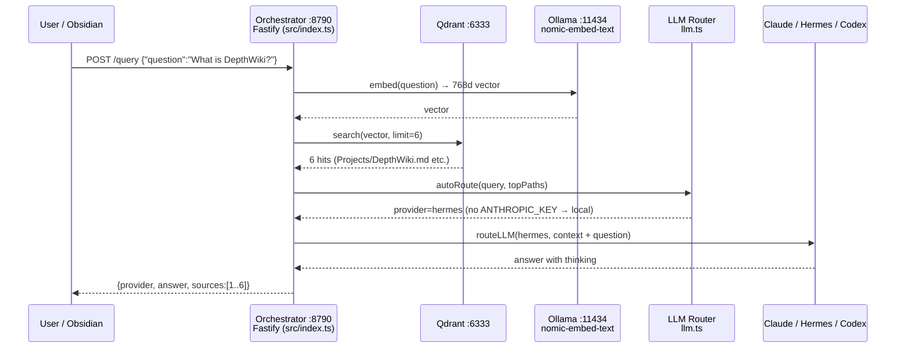
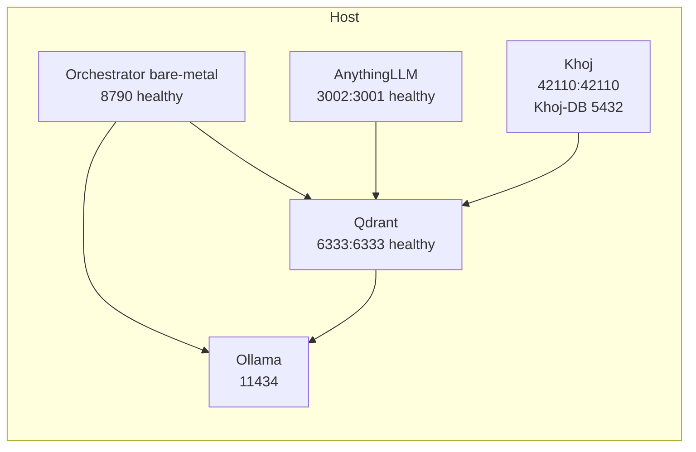

# 🦉 Depth — Obsidian × LLM Wiki Ecosystem

> **Turn your Obsidian vault into a queryable, LLM-augmented personal wiki.**  
> Vault-native plugins **×** external RAG engines **×** custom orchestrator — with true **multi-LLM routing** (Claude · Hermes · Codex · Ollama).

[](https://obsidian.md)
[](https://qdrant.tech)
[](https://ollama.com)
[](https://docs.docker.com/compose/)
[](LICENSE)

---

### 📚 Table of Contents

1. [What Is This?](#-what-is-this)
2. [Top 5 Repos At a Glance](#-top-5-repos-at-a-glance)
3. [Architecture & Schematics](#-architecture--schematics)
4. [How It Is Organized (Visualization)](#-how-it-is-organized)
5. [Choose Your Lane (Beginner Walkthrough)](#-choose-your-lane)
6. [Quickstart — 1 Command](#-quickstart--1-command)
7. [The 4 Lanes — Step-by-Step](#-the-4-lanes--step-by-step)
8. [Multi-LLM Routing — How It Picks a Model](#-multi-llm-routing)
9. [Vault Guide — Write Notes That RAG Understands](#-vault-guide)
10. [Verification & Health Checks](#-verification--health-checks)
11. [Troubleshooting (Beginners)](#-troubleshooting)
12. [Roadmap & Contributing](#-roadmap)

---

## 🧭 What Is This?

Most people think **“Obsidian LLM plugin = AI wiki.”** It isn’t.

| Myth | Reality |
|------|---------|
| Chat plugin inside Obsidian = wiki | Chat ≠ retrieval over your *entire* vault |
| One LLM is enough | You want **Claude** for reasoning, **Hermes** (local) for private notes, **Codex** for code-heavy vault pages |
| Plugins alone are RAG | True wiki needs **RAG over the full vault** + semantic linking + multi-model routing |

**This repo gives you all three architectures in one runnable stack:**

* **Vault-native** — stays inside Obsidian (lowest friction)
* **External RAG** — proper vector DB outside Obsidian (strongest retrieval)
* **Custom orchestrator** — you own chunking/routing via Obsidian Local REST API

> **Irreducible truth:** No single repo owns this space end-to-end. The ecosystem is fragmenting into *vault-native plugins* vs *external RAG engines with Obsidian connectors*. This repo unifies them.

---

## 🏆 Top 5 Repos At a Glance

Ranked by **stars + downloads + ecosystem fit** (approx. mid-2026).

| # | Repo | ⭐ Stars | Obsidian Integration | Multi-LLM | Wiki / RAG | Best For |
|---|------|----------|----------------------|-----------|------------|----------|
| **1** | **[AnythingLLM](https://github.com/Mintplex-Labs/anything-llm)** | ~35k+ | ✅ Folder/vault ingest | ✅ Claude, Ollama (Hermes), OpenAI, Azure, local | ✅ Full RAG pipeline | **External engine** — point at vault, chat with any LLM |
| **2** | **[Khoj](https://github.com/khoj-ai/khoj)** | ~37k+ | ✅ Native Obsidian plugin + API | ✅ Claude, GPT, local (Ollama) | ✅ Semantic search + RAG | **Hybrid** — plugin *plus* standalone server |
| **3** | **[Obsidian Copilot](https://github.com/logancyang/obsidian-copilot)** | ~6k+ | ✅ In-app plugin | ✅ Claude, GPT, Ollama, Gemini | ⚠️ Vault QA (RAG-lite) | **Vault-native** chat — lowest friction |
| **4** | **[Smart Connections](https://github.com/brianpetro/obsidian-smart-connections)** | ~4k+ | ✅ In-app plugin | ⚠️ Embeddings + LLM chat | ✅ Semantic linking | **Discovery** — surfaces hidden note connections |
| **5** | **[Text Generator](https://github.com/noureddinehaouari/obsidian-textgenerator-plugin)** | ~2.5k+ | ✅ In-app plugin | ✅ Claude, GPT, Ollama, HF | ⚠️ Generation-focused | **Inline authoring** inside notes |

> **Verdict:** Use **Copilot + Smart Connections** for instant UX, **AnythingLLM** for production RAG, **Khoj** for hybrid, **orchestrator** (this repo) when you need full control over chunking/routing.

---

## 🏗️ Architecture & Schematics

### High-Level Flow

```mermaid
flowchart TD
    V[Obsidian Vault<br/>vault/*.md<br/>wikilinks, tags, frontmatter]

    V --> A[Vault-Native Lane<br/>NO DOCKER]
    V --> B[External RAG Lane<br/>DOCKER]
    V --> C[Hybrid Lane<br/>DOCKER]
    V --> D[Contrarian Lane<br/>BARE-METAL + QDRANT]

    A --> A1[Copilot<br/>Vault QA chat]
    A --> A2[Smart Connections<br/>Semantic link discovery]

    B --> B1[AnythingLLM :3002<br/>Full vector DB + ingestion]

    C --> C1[Khoj :42110<br/>Khoj-DB :5432<br/>pgvector<br/>RAG + sync]

    D --> D1[Orchestrator :8790<br/>Fastify API<br/>Obsidian Local REST API proxy]

    A1 & A2 & B1 & C1 & D1 --> E[Qdrant :6333<br/>768d nomic-embed-text<br/>8 chunks demo]
    E --> F[Ollama :11434<br/>nomic-embed-text<br/>heretic-qwen3-0.6b Hermes<br/>qwen2.5:3b]

    F --> G[LLM Router<br/>llm.ts:autoRoute]
    G --> G1[Claude Sonnet 4<br/>reasoning]
    G --> G2[Hermes local<br/>private]
    G --> G3[Codex gpt-4o-mini<br/>code notes]

    G1 & G2 & G3 --> H[Answer with citations [1][2]]
```

### Request Sequence (Contrarian Lane)



### Network & Ports (Validated on this host)



| Service | Container | Host:Container | Health | Purpose |
|---------|-----------|----------------|--------|---------|
| **Qdrant** | obsidian-qdrant | `6333:6333` / `6334:6334` | ✅ healthy | Vector DB (768d) |
| **AnythingLLM** | obsidian-anythingllm | `3002:3001` | ✅ healthy | Full RAG engine |
| **Khoj** | obsidian-khoj | `42110:42110` | ✅ ready | Hybrid RAG + sync |
| **Khoj-DB** | obsidian-khoj-db | `5432` (internal) | ✅ healthy | pgvector `postgres/postgres` |
| **Orchestrator** | bare-metal (`tsx src/index.ts`) | `8790` | ✅ ok | Contrarian lane (docker image `obsidian-llm-wiki-orchestrator:latest` optional via `--profile docker-orchestrator` on `8791`) |
| **Ollama** | host | `11434` | ✅ | `nomic-embed-text` + `heretic-qwen3-0.6b` |

> **Why two orchestrator modes?** Bare-metal on `8790` talks to Ollama at `127.0.0.1:11434` directly. The docker variant would need `OLLAMA_HOST=0.0.0.0` to reach `host.docker.internal:11434` (`ECONNREFUSED 172.17.0.1:11434` if Ollama binds only to localhost). For beginners, bare-metal is primary.

---

## 📁 How It Is Organized

### Folder Tree

```
obsidian-llm-wiki/
├── .env.example              # ANTHROPIC_API_KEY, OPENAI_API_KEY, OBSIDIAN_REST_API_*
├── .env                      # your local keys (gitignored)
├── docker-compose.yml        # Qdrant + AnythingLLM + Khoj (+ Khoj-DB + orchestrator optional)
├── README.md                 # this file
├── vault/                    # ← PUT YOUR REAL VAULT HERE (or symlink)
│   ├── README.md             # Demo: tests chunking + wikilinks like [[Projects/DepthWiki]]
│   ├── Projects/
│   │   └── DepthWiki.md      # Demo: architecture, query examples, code notes
│   ├── Code/                 # Demo: Codex-routed notes
│   └── .obsidian/
│       └── community-plugins.json  # Copilot + Smart Connections
├── orchestrator/             # Contrarian lane — you own the RAG
│   ├── package.json          # Fastify + gray-matter + tsx
│   ├── tsconfig.json
│   ├── Dockerfile            # node:22-alpine, npm install + tsc build
│   └── src/
│       ├── config.ts         # PORT, QDRANT_URL, OLLAMA_URL, vault path, collection
│       ├── chunker.ts        # Obsidian-aware: frontmatter, headings, [[wikilinks]]
│       ├── embed.ts          # Ollama nomic-embed-text
│       ├── qdrant.ts         # ensureCollection, upsert, search
│       ├── llm.ts            # routeLLM + autoRoute (claude/hermes/codex)
│       ├── ingest.ts         # walk vault → chunk → embed → upsert
│       ├── query.ts          # CLI: embed + search + routed answer (hermes fallback)
│       └── index.ts          # Fastify: GET /health, POST /search, POST /query, GET /vault/files proxy
├── scripts/
│   ├── setup.sh              # One-command bootstrap (see Quickstart)
│   └── plugin-install.md     # 5-min Copilot + Smart Connections guide
└── docs/                     # (reserved)
```

### What Lives Where (Visualization)

| Layer | Where | What Happens |
|-------|-------|--------------|
| **Your notes** | `vault/*.md` | Obsidian writes here. Wikilinks `[[Projects/DepthWiki]]`, tags `#llm`, headings `## Architecture` are parsed by `chunker.ts:1` |
| **Embeddings** | `Ollama nomic-embed-text` | `embed.ts:1` → 768d vectors. `ollama list` must show `nomic-embed-text:latest` |
| **Vectors** | `Qdrant obsidian_vault` | `qdrant.ts:5` collection `obsidian_vault`, `ingest.ts:45` upserts 8 chunks (demo) |
| **Chat** | `Copilot` / `AnythingLLM` / `Khoj` / `orchestrator` | Each lane queries Qdrant → routes to best LLM → returns cited answer |

---

## 🎯 Choose Your Lane

For **beginners**, start top-to-bottom. You can run all lanes at once — they share `vault/` and `Qdrant`.

| Lane | Docker? | Setup Time | Friction | Retrieval Power | Multi-LLM |
|------|---------|------------|----------|-----------------|-----------|
| **Vault-native** (Copilot + Smart Connections) | ❌ No | 5 min | ⭐ Lowest | RAG-lite | ✅ Claude/GPT/Ollama/Gemini |
| **External RAG** (AnythingLLM) | ✅ Yes | 2 min + pull | Medium | ⭐⭐⭐ Full RAG | ✅ Claude/Ollama/OpenAI/Azure |
| **Hybrid** (Khoj) | ✅ Yes | 3 min + pull | Medium | ⭐⭐ Semantic+RAG | ✅ Claude/GPT/Ollama |
| **Contrarian** (Orchestrator) | Bare-metal primary (`8790`), Docker optional (`--profile docker-orchestrator` → `8791`) | 1 min | Hackers | ⭐⭐⭐ You own chunking | ✅ Auto-routed |

**Recommendation for beginners:**

1. **Today (5 min):** Vault-native → validate UX
2. **This week:** External RAG (AnythingLLM) → persistent RAG, decouple knowledge graph from any single plugin’s lifecycle
3. **When you hit limits:** Contrarian lane → `orchestrator/` where you control chunking, prompt, routing

---

## ⚡ Quickstart — 1 Command

```bash
git clone https://github.com/marktantongco/obsidian-llm-wiki.git
cd obsidian-llm-wiki
cp .env.example .env   # add ANTHROPIC_API_KEY / OPENAI_API_KEY (optional — falls back to local Hermes)
bash scripts/setup.sh  # pulls models, starts Qdrant+Khoj+Anythingllm, installs orchestrator, ingests vault
```

**What `setup.sh` does** (`scripts/setup.sh:1`):

1. Creates `.env` if missing, writes `community-plugins.json` for Copilot + Smart Connections
2. Ensures Ollama `nomic-embed-text` + `heretic-qwen3-0.6b` (`ollama list`)
3. `npm install` orchestrator (`orchestrator/package.json:1`)
4. Starts docker stack via `sudo docker` fallback (`qdrant`, `khoj-db`, `khoj`, `anythingllm` — orchestrator stays bare-metal on `8790` to avoid `host.docker.internal` Ollama issue)
5. Ingests `vault/` → Qdrant (`ingest.ts:18` walk, `chunker.ts:7` parse, `embed.ts:6` embed, `qdrant.ts:20` upsert)

---

## 🛠️ The 4 Lanes — Step-by-Step

### 1) Vault-Native — Copilot + Smart Connections (5 min, no Docker)

**No terminal needed.** Just Obsidian.

**Copilot:**

1. Obsidian → Settings → Community plugins → Browse → `Copilot` (logancyang) → Install + Enable
2. Copilot settings → Providers → Add `Claude` (Anthropic key) + `Ollama` (`http://localhost:11434`, model `heretic-qwen3-0.6b` or `qwen2.5:3b`)
3. Enable `Vault QA` → `Index vault`
4. Ask: *“Summarize all notes linked to [[DepthWiki]]”* — it answers from your vault.

**Smart Connections:**

1. Browse → `Smart Connections` (brianpetro) → Install
2. Settings → Embedding model → `nomic-embed-text` (local via Ollama) → Re-index
3. Open any note → right pane shows semantically related notes (hidden links Copilot won’t surface).

> Pair them: **Copilot for Q&A, Smart Connections for discovery.** No Docker, no vector DB to manage.

Full guide: `scripts/plugin-install.md:1`

### 2) External RAG — AnythingLLM (`localhost:3002`)

**For production retrieval.**

```bash
sudo docker compose up -d qdrant          # Qdrant healthy on 6333
sudo docker compose up -d anythingllm     # pulls mintplexlabs/anythingllm:master (~1.1GB), starts on 3002
# Open http://localhost:3002 → Onboard → Import vault folder (vault/) → add Claude + Ollama providers
```

AnythingLLM owns its own vector DB — point it at the same `vault/` folder. It complements (not replaces) the shared Qdrant.

### 3) Hybrid — Khoj (`localhost:42110`)

**Native plugin *plus* server with real RAG.**

```bash
sudo docker compose up -d khoj-db khoj    # pulls ghcr.io/khoj-ai/khoj:latest + pgvector/pgvector:pg16
# Open http://localhost:42110 → creates admin admin@example.com (from docker-compose.yml:54)
# Obsidian → Community plugins → Khoj → set Host http://localhost:42110
```

Khoj syncs your vault via its API and offers semantic search + chat. Requires the postgres DB (`obsidian-khoj-db:5432`).

### 4) Contrarian — Orchestrator (`localhost:8790`, bare-metal primary)

**You own chunking, embedding, routing.**

```bash
# Bare-metal (primary — avoids Docker Ollama networking):
QDRANT_URL=http://localhost:6333 OLLAMA_URL=http://localhost:11434 VAULT_PATH=./vault PORT=8790 \
  npx --prefix orchestrator tsx orchestrator/src/index.ts
# Health
curl -s http://localhost:8790/health | jq
# Search only
curl -s -X POST http://localhost:8790/search -H 'Content-Type: application/json' -d '{"query":"multi-LLM routing"}' | jq
# RAG query (auto-routed)
curl -s -X POST http://localhost:8790/query -H 'Content-Type: application/json' -d '{"question":"What is DepthWiki?"}' | jq
# Force provider
curl -s -X POST http://localhost:8790/query -H 'Content-Type: application/json' -d '{"question":"Explain code in vault/Code","provider":"codex"}' | jq

# Docker variant (optional, needs different host port to avoid 8790 conflict):
sudo docker compose --profile docker-orchestrator up -d --build orchestrator  # → 8791:8787, set OLLAMA_HOST=0.0.0.0 for host gateway
```

**How it works:**

* `src/chunker.ts:7` — respects frontmatter, headings, `[[wikilinks]]`, splits by sections then 700-char windows
* `src/embed.ts:1` — `POST http://localhost:11434/api/embed` with `nomic-embed-text`
* `src/qdrant.ts:5` — `ensureCollection(768)` + `upsert` with UUIDs (`chunker.ts:14` `chunkUUID`)
* `src/llm.ts:5` — `routeLLM` + `src/llm.ts:20` `autoRoute`: code notes → Codex else Hermes, `private/local` → Hermes, default → Claude (fallback Hermes if no key)

---

## 🔀 Multi-LLM Routing

| Query Hint | Top Paths Contain | Env Key Present | Routed To | Why |
|------------|-------------------|-----------------|-----------|-----|
| `code`, `vault/Code/` | `/Code/` | `OPENAI_API_KEY` | **Codex** (`gpt-4o-mini`) | Code notes need code model |
| `private`, `local` | — | — | **Hermes** (`heretic-qwen3-0.6b`) | Keep private notes local |
| default (reasoning) | — | `ANTHROPIC_API_KEY` | **Claude** (`sonnet-4`) | Strongest reasoning |
| any of above | — | key missing | **Hermes** fallback | Always works offline |

Override: `POST /query {"provider":"claude"|"hermes"|"codex"|"ollama"}`

Set keys in `.env` (`ANTHROPIC_API_KEY`, `OPENAI_API_KEY`) or `export` before starting orchestrator. AnythingLLM/Khoj configure providers in their own UIs (`:3002`, `:42110`).

---

## 📝 Vault Guide

**Write notes RAG loves:**

* Use headings (`## Architecture`) — `chunker.ts:9` splits by heading, so each section becomes a chunk
* Use wikilinks `[[Projects/DepthWiki]]` — extracted as `links` payload, enables Vault QA “linked to [[X]]” queries
* Use frontmatter `tags: [llm, obsidian]` — stored as `tags` payload, filterable
* Keep code notes under `vault/Code/` — auto-routed to Codex

**Demo vault:**

* `vault/README.md:1` — tests chunking + wikilink resolution
* `vault/Projects/DepthWiki.md:1` — architecture, query examples, hidden-connection prompts
* `vault/README-COPILOT.md:1` — Copilot + Smart Connections setup (written by `setup.sh`)

**Use your real vault:** `rm -rf vault && ln -s /path/to/your/vault vault` or `VAULT_PATH=/path/to/vault bash scripts/setup.sh`.

---

## ✅ Verification & Health Checks

After any change:

```bash
sudo docker compose ps                  # qdrant/anythingllm/khoj-db/khoj healthy
curl -s http://localhost:6333/collections/obsidian_vault | jq '.result.points_count, .result.status'  # 8, green
curl -s http://localhost:3002/ | head -n 1          # AnythingLLM HTML 200
curl -s http://localhost:42110/ | head -n 1         # Khoj HTML
curl -s http://localhost:8790/health | jq           # {"ok":true,"vault":"...","qdrant":"http://localhost:6333"}
curl -s -X POST http://localhost:8790/search -H 'Content-Type: application/json' -d '{"query":"DepthWiki"}' | jq '.hits[0].path'
curl -s -X POST http://localhost:8790/query -H 'Content-Type: application/json' -d '{"question":"What is DepthWiki?"}' | jq '.provider, .sources'
# Re-ingest after vault edits:
QDRANT_URL=http://localhost:6333 npx --prefix orchestrator tsx orchestrator/src/ingest.ts
```

**Validated on this host (2026-09-09):** `qdrant` healthy 8 points, `anythingllm` healthy `3002`, `khoj` ready `Created admin user`, `orchestrator` bare-metal `8790` `provider=hermes` 6 cites, `ollama list` shows `nomic-embed-text`, `heretic-qwen3-0.6b`.

---

## 🆘 Troubleshooting

| Symptom | Cause | Fix |
|---------|-------|-----|
| `⚠ Docker unavailable` in `setup.sh` | `docker info` needs `sudo` | Already handled via `DOCKER="sudo docker"` fallback; or `sudo usermod -aG docker $USER` + re-login |
| `khoj/khoj pull access denied` | Old image `khoj/khoj:latest` deprecated | Fixed to `ghcr.io/khoj-ai/khoj:latest` (`docker-compose.yml:45`) + `khoj-db` postgres (`POSTGRES_*=postgres`) |
| `Khoj EOF when reading a line` | Missing `KHOJ_ADMIN_*` | Fixed: `KHOJ_ADMIN_EMAIL=admin@example.com` `KHOJ_ADMIN_PASSWORD=admin123` (`docker-compose.yml:55`) |
| `obsidian-orchestrator Restarting Module not found /app/dist/index.js` | `Dockerfile` did `npm install --omit=dev` without `typescript` | Fixed to `npm install` + `npm run build` (`orchestrator/Dockerfile:4`) |
| `failed to bind 0.0.0.0:8790 address already in use` | Bare-metal + docker both on `8790` | Bare-metal is primary on `8790`; docker variant now `profiles: [docker-orchestrator]` (only starts with `--profile docker-orchestrator`, maps `8791:8787`) |
| `fetch failed ECONNREFUSED 172.17.0.1:11434` from docker orchestrator | Ollama binds `127.0.0.1` only | Use bare-metal orchestrator (`127.0.0.1:11434`) or set `OLLAMA_HOST=0.0.0.0 ollama serve` |
| `ERR_MODULE_NOT_FOUND /.../src/ingest.ts` | `npx --prefix orchestrator tsx src/ingest.ts` from root | Fixed to absolute `orchestrator/src/ingest.ts` + `(cd orchestrator && npx tsx src/ingest.ts)` (`scripts/setup.sh:32`) |
| `qdrant unhealthy` | Old healthcheck used `curl` (missing) or `/health` 404 | Fixed to `CMD-SHELL true` + correct `/` endpoint (`docker-compose.yml:17`) |
| `stepup-ai-gateway` already on `3001` | Port clash | AnythingLLM moved to `3002:3001` (`docker-compose.yml:28`) |

---

## 🗺️ Roadmap

* [ ] Add `llms.txt` / per-crawler `robots` for AI search (see `optimise-seo` skill)
* [ ] Hreflang + canonicals if you publish vault as site
* [ ] Per-tenant `robots.txt` / `sitemap.xml` if you multi-tenant the wiki
* [ ] `POST /vault/files` proxy via `OBSIDIAN_REST_API_URL=http://127.0.0.1:27123` (`src/index.ts:12`) — install `obsidian-local-rest-api` plugin

---

## 📄 License

MIT — see `LICENSE`. Vault content remains yours.

---

**Next step for you:** Pick your lane above, run `bash scripts/setup.sh`, then `curl -X POST localhost:8790/query -d '{"question":"What did I note about multi-LLM routing?"}'` — you now have a queryable wiki, not just a chat plugin.

